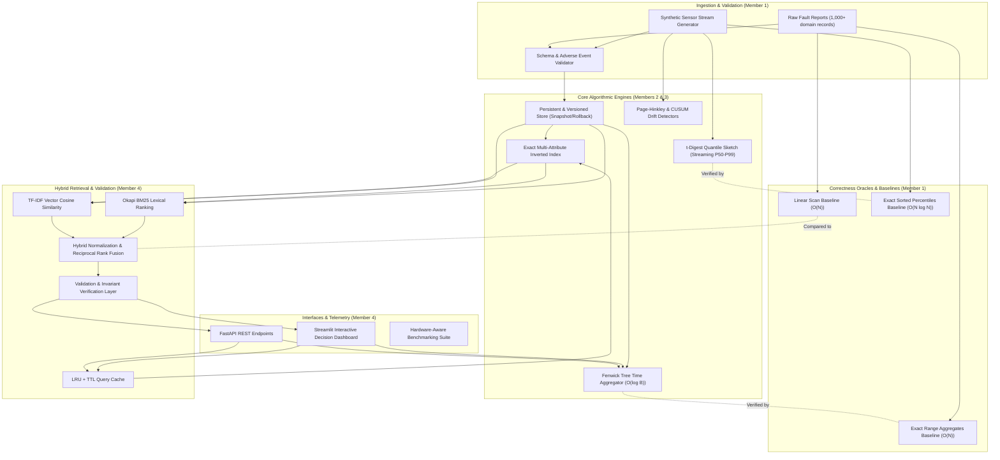

# System Architecture & Data Flow

## 1. Overview
The **Renewable Energy Fault Report Search and Sensor Stream Analytics** system is a local decision-support platform designed for renewable energy plant engineers and maintenance planners. It couples continuous sensor stream telemetry with historical fault report retrieval across solar photovoltaic (PV) and wind turbine installations.

---

## 2. Component Pipeline Description

1. **Ingestion & Validation Layer (Member 1)**:
   - Validates incoming events against strict Pydantic v2 domain schemas (`FaultReport`, `SensorReading`, `TimeInterval`, `SensorRange`).
   - Flags adverse anomalies: duplicate IDs, inverted intervals ($t_{start} > t_{end}$), non-numeric NaNs, and out-of-order/late timestamped readings.

2. **Exact Indexing & Persistence Layer (Member 2)**:
   - **Fenwick Tree (Binary Indexed Tree)**: Discretizes event start timestamps into hourly time buckets ($B = \lceil \Delta T / 3600 \rceil$), supporting range sum and count aggregations in $O(\log B)$ time.
   - **Persistent Store**: Implements snapshot versioning with immutable audit logging and instant rollback to historical states.
   - **Inverted Index**: Maintains posting lists for discrete categorical attributes (asset type, component, severity, metric name) enabling rapid candidate pre-filtering.

3. **Probabilistic Summaries & Drift Detection (Member 3)**:
   - **t-Digest**: Online cluster-based sketch maintaining dynamic centroids $(m_i, w_i)$. Compresses thousands of continuous readings into bounded $O(\delta)$ memory with extreme accuracy at tails ($P_{90}, P_{95}, P_{99}$).
   - **Streaming Concept Drift**: Implements the **Page-Hinkley test** to detect progressive component degradation (e.g. rising bearing vibration) and **CUSUM** to flag sudden step changes.

4. **Hybrid Retrieval & Interface Layer (Member 4)**:
   - Combines structured set filtering with **Okapi BM25** probabilistic scoring and **TF-IDF vector cosine similarity**.
   - Applies the **Candidate Validation Layer**: vector and lexical candidates are never presented as confirmed matches without re-validating physical sensor ranges and constraints.
   - Exposes features through both a **FastAPI REST API** and an interactive **Streamlit Dashboard**.

